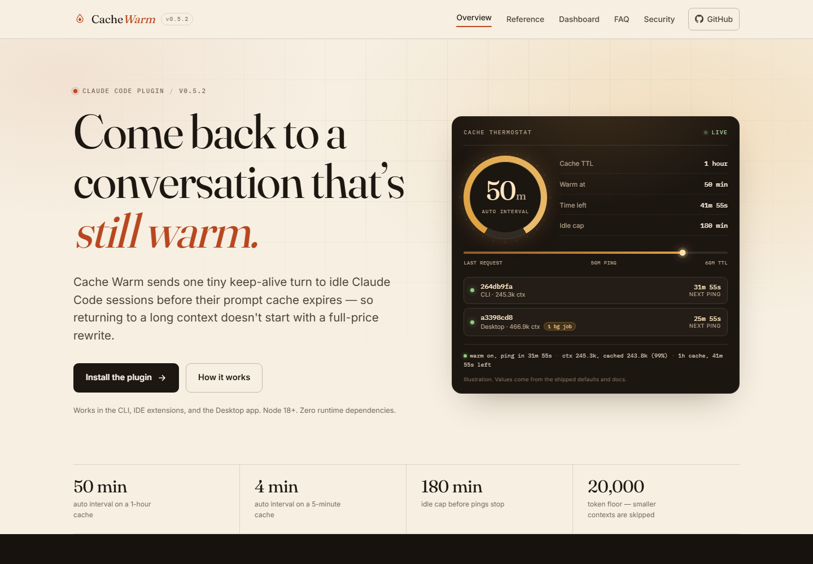
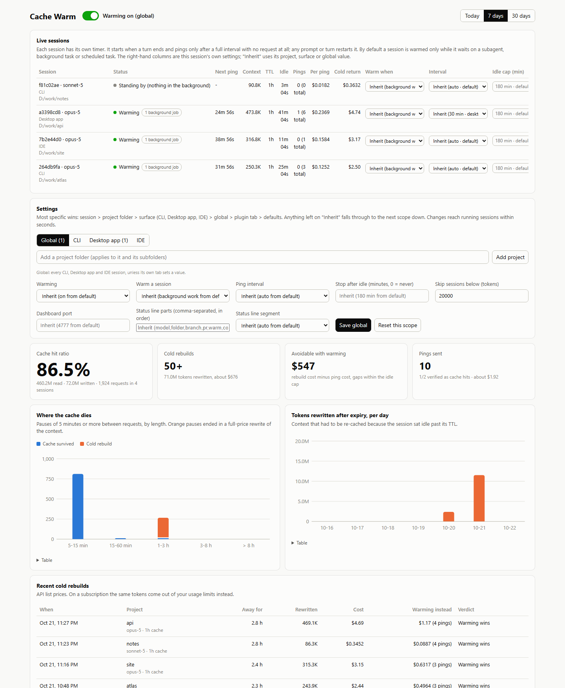
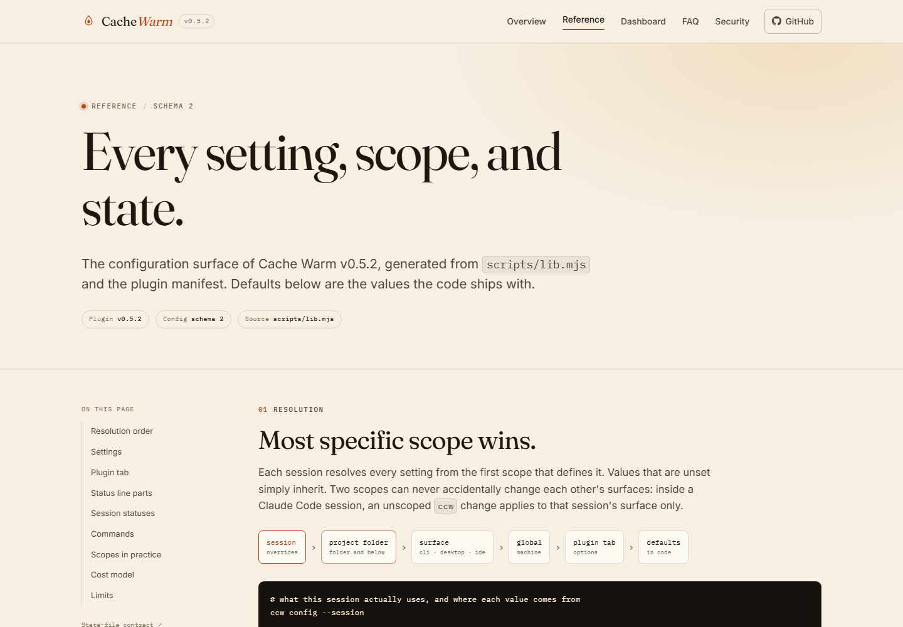
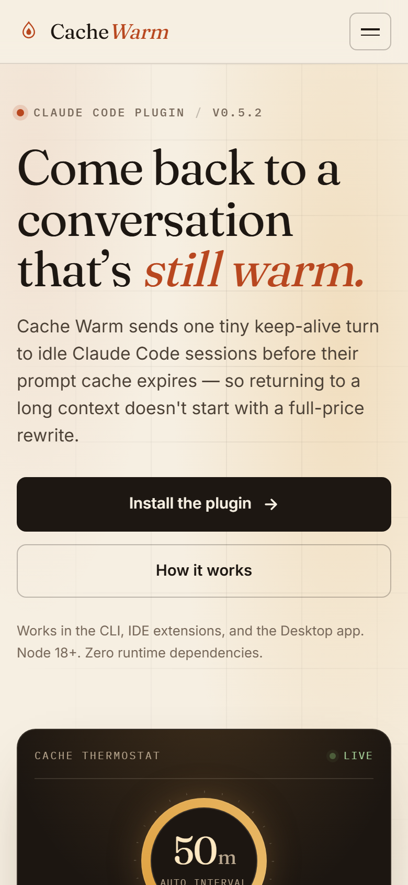

# Cache Warm

**Keep-alive pings for idle Claude Code sessions, so coming back to a long conversation doesn't start with a full-price cache rewrite.**

[](https://github.com/FiredMosquito831/claude-cache-warm/actions/workflows/ci.yml)
[](CHANGELOG.md)
[](LICENSE)
[](package.json)
[](https://cachewarm.danubelabs.net)

**Documentation and configuration reference: [cachewarm.danubelabs.net](https://cachewarm.danubelabs.net)** · [Tutorial](docs/TUTORIAL.md) · [State contract](docs/CONTRACT.md) · [Changelog](CHANGELOG.md)

<p align="center">
  <a href="https://cachewarm.danubelabs.net"></a>
</p>

Cache Warm is a Claude Code plugin. At every turn end it starts one small waker for that session. The waker waits until one interval after the conversation's last request, checks that the session is still idle and still worth warming, then wakes it with a single keep-alive line. Claude answers `ok`; that turn reads the whole context from cache and resets the TTL. An ordinary hook, no daemon, no scheduled task.

* **Scoped settings** — session, project folder, surface (CLI / Desktop / IDE), global, plugin tab, defaults. Anything unset inherits; the CLI and Desktop app cannot change each other by accident.
* **Status line segment** — warming state, ping countdown, context, cached tokens and time left. Wraps your existing status line instead of replacing it. On by default.
* **Self-checking** — every ping is judged against the transcript. Two misses in a row suspend warming for that session. `/cache-warm:test` proves the whole loop in your session.
* **Local dashboard** — live sessions and countdowns, every scope's settings, and cache analytics mined read-only from your own transcripts. Loopback only.
* **Optional tray app** — a thin Tauri v2 app with global hotkeys and a tray toggle.
* **Zero runtime dependencies.** Node 18+. Works in the CLI, IDE extensions and the Desktop app.

<p align="center">
  
  <br><sub>Local dashboard, sample data. Each session has its own timer and its own effective settings.</sub>
</p>

## Why

Claude Code re-sends the whole conversation on every turn. The prompt cache makes that cheap — a cache read is 0.1× input price (0.025× on Fable 5.1) — but the cache expires after a period of silence: **5 minutes** on an API key, **1 hour** on a Claude subscription or with `CLAUDE_CODE_PROMPT_CACHE_TTL=1h`. The first turn after expiry re-writes everything at 1.25× (5m) or 2× (1h) input price, and is slow.

Every cache hit resets the timer. One tiny turn shortly before expiry keeps a big context alive for a fraction of the rebuild:

| 800K-token context on Opus 5, 1h cache | Cost (list price) |
| :--- | ---: |
| One keep-alive ping (cache read) | ~$0.40 |
| Cold return after 90 minutes (cache write) | ~$8.00 |

That example is produced by the plugin's own estimator (`estimateCosts` in `scripts/lib.mjs`); one rebuild buys roughly 19 pings. On a subscription the same tokens come out of your usage limits instead. The dashboard shows what your actual pauses cost before you change anything.

## Install

Inside Claude Code:

```text
/plugin marketplace add FiredMosquito831/claude-cache-warm
/plugin install cache-warm@claude-cache-warm
```

Then start a new session, or run `/reload-plugins`. Updating later: `/plugin` → update, then `/reload-plugins` in every open session.

Requirements:

* **Node 18+** on `PATH`.
* A Claude Code recent enough to pass `background_tasks` to Stop hooks and support `asyncRewake` hooks (2.1.29x has both).

## Quickstart

```text
/cache-warm:status      # sessions, what each is waiting on, next ping, per-ping cost
/cache-warm:test        # one ping a minute after this turn, verified, settings restored
```

The defaults are conservative. A session is pinged only when warming is on for its scope, something is pending in the background, the conversation has been silent for one interval, the cache is still alive, activity happened within the idle cap, the context is at least 20K tokens, and the ping cap has not been reached. `ccw when always` warms any idle session in a scope instead.

The shell CLI is `ccw` (`bin/ccw` is on the Bash tool's `PATH`; from a plain terminal use `node scripts/ccw.mjs`):

```sh
ccw status                  # live sessions and countdowns
ccw config --session        # effective values and where each came from
ccw on | off [scope]
ccw interval 30 --project
ccw when always --desktop
ccw test
ccw dashboard
ccw doctor
```

## How it works

```text
Stop hook (asyncRewake)                                UserPromptSubmit hook
  every turn end starts one waker for that session       a new turn starts: the sleeping
  records the turn and Claude Code's own                 waker stands down; the next
  background_tasks / session_crons                       turn end starts a fresh one
  │
  ▼
  sleeps until  last request + interval
  │ re-checks: still idle? background work pending?
  │             settings for THIS session? cache alive?
  ▼
  exit 2  ──►  Claude Code wakes the idle session with one line
               → Claude answers "ok" → one cache read resets the TTL
```

* **The timer restarts on every request.** A prompt you type, a background agent reporting back, a scheduled task firing — each supersedes the sleeping waker. A session in use is never pinged, and nothing fires mid-turn.
* **One waker per session, no shared engine.** Each session resolves its own settings and has its own timer. There is no global engine switch to flip.
* **No scheduled tasks and no monitor process.** It is an ordinary hook, so it runs identically wherever Claude Code runs hooks. (0.2's cron/monitor engine was removed; see [CHANGELOG](CHANGELOG.md).)
* **Pings are verified.** Once a ping's `ok` reaches the transcript, the next waker judges that turn's usage. A cache read is a hit; a rewrite is a miss. Two misses in a row suspend warming for that session until someone is active again.
* **Hooks fail closed.** Errors go to the local event log; a hook never blocks a prompt. If a waker dies, pings stop until the next turn end.

It refuses to ping when nothing is pending in the background (default policy), the cache has already expired, nobody has been active within `maxIdleMinutes`, the ping cap is reached, the context is below `minContextTokens`, warming is off for that scope, or the session is headless (`claude -p`, Agent SDK). Keep-alive turns, scheduled-task prompts and background-task reports do not count as human activity, so the idle cap really means nobody has been here.

## Configuration

Settings live in `~/.claude-cache-warm/config.json` (override with `CCW_HOME`). Only explicitly set values are stored; everything else inherits.

| Setting | Default | Meaning | Scopes |
| :--- | :--- | :--- | :--- |
| `enabled` | `true` | On / off | all |
| `warmWhen` | `background-work` | `background-work`: only while something is pending in the background. `always`: any idle session | all |
| `intervalMinutes` | `auto` | From the last request. `auto` = 50 on a 1h cache, 4 on a 5m cache. Must be shorter than the TTL | all |
| `maxIdleMinutes` | `180` | Stop after this long with no activity. `0` = never | all |
| `minContextTokens` | `20000` | Smaller contexts are cheap to rebuild; skip them | all |
| `dashboardPort` | `4777` | Local dashboard port | global only |
| `statusline` | `auto` | `auto`, `wrap-only`, `off`; `off` restores the originals exactly | global only |
| `statuslineSegments` | `model,folder,branch,pr,warm,context,cache,fill,limits` | Parts of the status line, in order; `cost` is available but opt-in | global only |
| `desktopMode` | `same-as-cli` | Plugin tab only: `same-as-cli`, `off`, `background-work`, `always` for Desktop sessions | plugin tab |

The most specific scope wins:

```text
session  >  project folder  >  surface (cli | desktop | ide)  >  global  >  plugin tab  >  defaults
```

A project scope covers that folder and everything below it (deepest match wins). Inside Claude Code, an unscoped `ccw` change applies only to that session's surface: `ccw off` in the Desktop app turns off Desktop sessions, not your CLI ones. Use `--global` for every surface. From a plain terminal, no flag means global. Plugin-tab edits apply immediately through the `ConfigChange` hook, and sleeping timers pick them up within a minute.

Full option descriptions and validation rules: **[configuration reference](https://cachewarm.danubelabs.net/reference/)**. Every state file and the dashboard HTTP API: [docs/CONTRACT.md](docs/CONTRACT.md).

<p align="center">
  
  
  <br><sub>The generated docs site: configuration reference on desktop, the same design at 390&nbsp;px.</sub>
</p>

### Commands and scopes

| In Claude Code | Shell | |
| :--- | :--- | :--- |
| `/cache-warm:on [scope]` | `ccw on [scope]` | Switch on |
| `/cache-warm:off [scope]` | `ccw off [scope]` | Switch off |
| `/cache-warm:status` | `ccw status [--all] [--json]` | Sessions and countdowns |
| `/cache-warm:config …` | `ccw config`, `ccw scopes` | Effective settings / every scope with settings |
| `/cache-warm:dashboard` | `ccw dashboard` | Local web dashboard |
| `/cache-warm:statusline` | `ccw statusline install \| auto \| off` | Status line segment |
| `/cache-warm:test` | `ccw test` | One verified ping, then settings restored |
| | `ccw doctor`, `ccw events 30` | Health checks, recent log |

Scope flags: `--session`, `--project[=<folder>]`, `--cli`, `--desktop`, `--ide`, `--global`. Slash commands accept the same scopes as words: `/cache-warm:off desktop`, `/cache-warm:on session`.

## Status line

On by default (`statusline: auto`). At every session start the plugin keeps the segment on the status line that session will show. It wraps your existing command and prints its output first, untouched; `off` restores every original exactly. A status line defined in a project's shared `settings.json` is never edited — the segment goes into a personal, git-ignored `settings.local.json` overlay instead.

```text
⬆ /gsd-update │ Opus 5.5 │ me │ ● warm on, ping in 31m 55s (1 bg job) · ctx 245.3k, cached 243.8k (99%) · 1h cache, 41m 55s left
```

Parts, in the order you choose: `model` (with effort), `folder` (with subfolder), `branch`, `pr` (review state), `warm`, `context`, `cache`, `fill` (context window used), `limits` (5-hour and 7-day usage), `cost` (list-price estimate, off by default). Long lines wrap onto the next row at part boundaries.

```sh
ccw set statuslineSegments model,folder,branch,warm,context,cache,fill,limits
ccw statusline auto | wrap-only | off
ccw statusline install [--newline] [--refresh=<s>] [--file=<settings.json>]
ccw statusline uninstall
```

The line refreshes every 5 seconds. Your own command runs first and concurrently; its output is reused on timer-only refreshes so the tick stays cheap. Settings files are backed up as `*.ccw-backup` before the first change.

## Dashboard and tray app

```sh
ccw dashboard      # or /cache-warm:dashboard
```

Binds to `127.0.0.1` only. Live sessions, next-ping countdowns, per-session settings, every scope's settings with inherited values, and analytics computed read-only from `~/.claude/projects/**/*.jsonl`: hit ratio, cold rebuilds, avoidable cost, verified pings, pause distribution. Write endpoints reject cross-origin requests. More: [dashboard guide](https://cachewarm.danubelabs.net/dashboard/).

The optional tray app lives in [`desktop/`](desktop/README.md) (Tauri v2). `Ctrl+Alt+W` toggles global warming, `Ctrl+Alt+D` opens the dashboard.

```sh
cd desktop && npm install && npm run dev    # or: npm run build
```

## Costs and caveats

* A ping is a real model turn: one cache read of the full context plus a few output tokens. On a subscription it counts against your usage limits; on an API key it is billed. `ccw status` shows the estimate per session.
* Each ping adds two short messages to the conversation: a "Stop hook feedback" note carrying the keep-alive line, and Claude's `ok`.
* A foreground subagent blocks the main conversation inside a tool call; nothing can refresh the main cache until it returns. Warming covers background work.
* Things that invalidate the cache anyway — a model switch, `/compact`, MCP tools changing, upgrading Claude Code — are outside this plugin's reach. See [How Claude Code uses prompt caching](https://code.claude.com/docs/en/prompt-caching).
* Headless runs (`claude -p`, Agent SDK) are never registered or warmed.
* The tray app is optional and its development notes target Windows; every other feature is platform-neutral Node.js.
* Defaults are deliberately conservative. Read the [FAQ](https://cachewarm.danubelabs.net/faq/) before switching a large scope to `when always`.

### Upgrading from 0.2

0.2 used a global engine switch, a plugin monitor and a scheduled-task fallback; a Desktop session could force cron pings on every CLI session. 0.3 replaced all of it with the per-session Stop-hook waker. The state directory is migrated automatically on the first hook run after updating, with a backup at `config.v1.backup.json`. Leftover 0.2 crons delete themselves when they next fire. See [CHANGELOG.md](CHANGELOG.md) for details.

## Development

```sh
npm test                                   # 22 end-to-end tests: real hook, waker and CLI
claude plugin validate .                   # marketplace manifest
claude plugin validate .claude-plugin/plugin.json
node --check scripts/lib.mjs

python -m pip install -r requirements-site.txt
python scripts/build_site.py               # docs/ from site/ + repo data
python scripts/build_site.py --check       # stale-output check (CI)
npm run dashboard                          # against the current CCW_HOME
```

The site is generated by `scripts/build_site.py` (Jinja2) from `site/`. Version, defaults, option metadata and status names come from `package.json`, `scripts/lib.mjs` and `.claude-plugin/plugin.json`; the output is deterministic. Screenshots are real Playwright captures of the site and of the dashboard running against seeded sample data (`scripts/capture_site.py`). See [CONTRIBUTING.md](CONTRIBUTING.md).

Layout: `.claude-plugin/` manifest and marketplace, `hooks/`, `skills/`, `scripts/` (`lib.mjs` core, `hook.mjs`, `waker.mjs`, `ccw.mjs`, status line), `dashboard/`, `desktop/`, `site/`, `docs/` (generated site plus [tutorial](docs/TUTORIAL.md) and [state contract](docs/CONTRACT.md)).

## Security

The plugin has no network client, no telemetry and no runtime dependencies. Its only listening socket is the loopback dashboard, and its analytics read local transcripts read-only. Details and reporting: [SECURITY.md](SECURITY.md) and [the security page](https://cachewarm.danubelabs.net/security/).

## License

MIT © 2026 FiredMosquito831. See [LICENSE](LICENSE).
